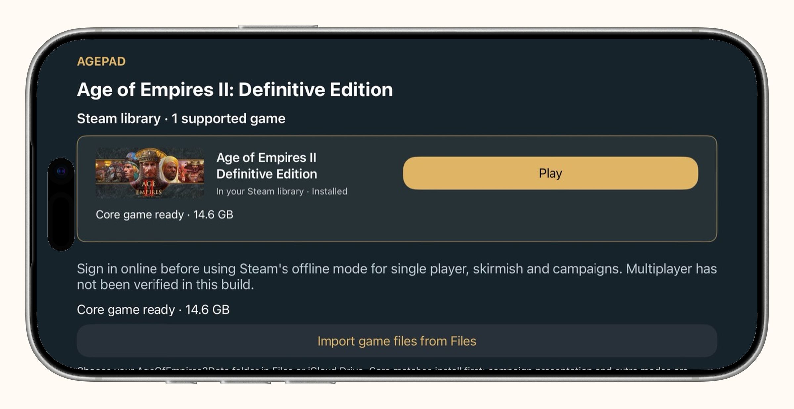
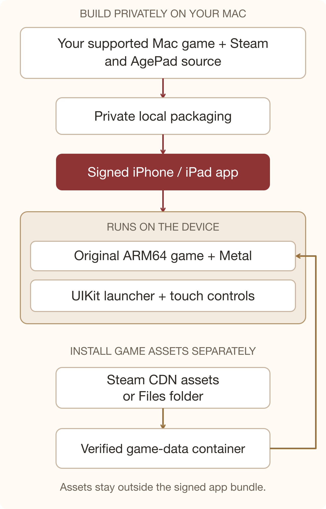

# AgePad for iPhone and iPhone Duo

A development fork of [chrissotraidis/agepad](https://github.com/chrissotraidis/agepad)
that brings its native Age of Empires II: Definitive Edition compatibility layer
to ordinary iPhones and iPhone Duo, while retaining iPad support.

**An actual game has started on a physical iPhone 17 Pro Max.** This is still a
developer preview: the original desktop HUD needs more phone work, Duo folding
can stretch the rendered image, and sustained performance is not qualified.
This fork's changes are on the `iphone` branch. Upstream remains the source of
the original iPad implementation; its releases do not include these additions.

Bring your own supported **Mac Steam installation of AoE II: DE** and Steam
account. This repository distributes source, build tools and original AgePad
assets. Personal app builds contain files from your own game and Steam
installation and must stay private. There is no downloadable game or ready-made
IPA in this fork, and no TestFlight release.

## Screenshots



Steam library after sign-in, with the core game ready to play. User-provided
phone capture in a landscape iPhone 17 Pro Max frame; no gameplay is shown.

## Differences from upstream

The comparison below is against upstream commit
[`88afa37`](https://github.com/chrissotraidis/agepad/tree/88afa37), the starting
point for this work. It does not claim that later upstream work lacks a feature.

| Area | This fork adds or changes |
| --- | --- |
| Devices and presentation | Universal iPhone/iPad packaging, landscape phone support, scene sizing and safe-area handling; a logical game canvas large enough for the engine's minimum resolution. |
| Touch controls | Compact red-and-gold COMMANDS/BACK controls, explicit order mode, and a hold–drag–release command wheel. Touch targets remain at device UI scale. |
| Duo adaptation | Safe placement around division/occlusion regions, cancellation during geometry changes, and scene/screen notifications to the original engine. Renderer resizing across folds remains incomplete. |
| Steam sign-in | Native password/Steam Guard flow, QR polling and reconnect handling, saved Keychain sign-in, and ownership lookup restricted to AoE II: DE (app 813780). |
| Library | A native game card with installation status and an explicit Download or Play action. Private builds can supply publisher artwork; source-only builds use a system icon. |
| Game data | A separate, version-pinned core asset pack, Files folder import, verified replacement and cleanup. Assets stay outside the signed app bundle. |
| Downloads | Direct Steam CDN asset downloads through a persistent background URLSession, progress, Pause/Resume/Cancel, chunk validation and a durable recovery journal. |
| Packaging | Flat framework layout and image map, public UIKit launcher mode, privacy API declarations for owned code, signing/profile checks and distribution preflight. |
| Reliability | Installation serialization, asynchronous readiness gating, stale callback checks, shared hash/protobuf helpers, and synthetic native regression fixtures. |

The latest personal development package is about **188.7 MB**. Its separate
English core asset profile is **14.6 GB**, compared with a 22.8 GB full source
data folder for the pinned build. These are different sizes: shrinking the app
bundle does not eliminate the game's installed storage requirement. See
[game-data installation](docs/GAME-DATA.md) for exact counts, exclusions and
storage requirements.

## Controls

- Tap to select; drag to box-select. Pan and pinch navigate the map.
- Hold a map point for 0.45 seconds, slide to ORDER, IDLE, TOWN, ZOOM or MENU,
  then lift. Returning to the center or moving beyond the wheel cancels.
- Tap COMMANDS for accessible buttons without a timed gesture. ORDER arms the
  next map tap; CANCEL ORDER disarms it.
- BACK cancels adapter input and sends the existing guarded Escape action.
  Some original modals and building-placement states are not reliably detected.
- Pencil, mouse, keyboard and the existing two-finger order route remain.

Custom controls use the game's red-and-gold visual language. The original
build/research panel and minimap still need a complete touch solution. The
[phone control research](docs/IPHONE-CONTROLS.md) covers Company of Heroes,
Total War, console AoE controls and the next overlay experiments. Research
prototypes described there are not all enabled in the current app.

## Technical approach

The game runs locally on the device. The working route uses the Mac game's
existing ARM64 executable and Metal renderer, with AgePad libraries providing
the desktop APIs it expects on iOS. AgePad is not built from AoE source code.



The packager rewrites Mach-O platform metadata, library dependencies and signing
information. It verifies the original file-backed sections against the expected
inputs; unknown layouts and mismatched versions fail checks. The owned-code
boundary translates window, input, audio and other platform calls. UIKit
controls forward commands through that boundary to the original game.

The native Steam route signs in to Steam, checks actual ownership and uses the
locally packaged Steam client components. The content downloader fetches
**assets**, not replacement executable code. It requests the pinned depots,
decrypts/decompresses chunks, validates their checksums, then checks assembled
files against a private SHA-256 manifest before adopting them. No ownership
result is fabricated. An unavailable required depot or incompatible build must
be resolved with a matching supported installation.

Queued HTTPS asset transfers can continue while iOS suspends AgePad. Sign-in,
manifest preparation and final verification require the foreground app. iOS
controls scheduling; force-quitting interrupts background transfers. Reopening
can restore verified progress. Real CDN/background-daemon recovery still needs
broader device qualification; native journal tests do not prove that entire flow.

The optional older Mac relay route remains in the source. It relays Steam
services, not rendered gameplay. The primary phone route does not need the Mac
running while playing once the compatible app and data are installed.

## Status and known limits

| Evidence | What it establishes |
| --- | --- |
| Physical iPhone 17 Pro Max | A user started an actual game with the signed Increased Memory Limit capability. Build 16 is the subsequent cleanup candidate. |
| iPhone 17 Simulator | Saved skirmish loading and basic select/order/idle/back controls in landscape. |
| iPhone Duo Simulator | Open-display skirmish and command wheel; closing/rotation can stretch the game image until reopened. |
| Native fixtures and device SDK builds | Input geometry, protocol/decoder integrity, download bookkeeping, import recovery, readiness gating and boundary compilation/linking. These are not an end-to-end device acceptance test. |

The working physical route required a real Apple profile grant for Increased
Memory Limit: initial loading exceeded the previous approximately 3.3 GiB
allowance. The observed startup peak was approximately 4.1 GiB. That is a
loading measurement, not a minimum-RAM specification or a sustained-gameplay
benchmark. Other iPhones, long matches, heat/battery behavior, multiplayer,
campaigns and excluded content are not qualified.

Further work includes a readable original-HUD overlay, Duo renderer
reconfiguration, sustained device profiling, actual UIKit sign-in panel
lifecycle tests, and end-to-end background-download recovery. Public launcher
mode removes a known private web-host dependency; it does not certify every
vendor library or establish App Store acceptance.

## Build and contribute

Start with [the phone source-build guide](docs/BUILD-IPHONE.md). You need an
Apple Silicon Mac, the supported Steam game and client, Xcode/iOS SDK 27.1 for
full Duo behavior, and your own device signing setup. The tested physical
configuration uses a development profile that actually grants Increased Memory
Limit. Upstream base IPAs cannot acquire this fork's new compiled controls by
injection alone.

Useful entry points:

- [Contribution guide](CONTRIBUTING.md): local experimentation does not require a PR.
- [Phone and Duo behavior](docs/IPHONE-DUO.md): geometry, controls and validation.
- [Game data](docs/GAME-DATA.md): separate Steam downloads, Files import and cleanup.
- [Public launcher boundary](docs/PUBLIC-LAUNCHER.md) and [owned-code privacy declarations](docs/PRIVACY-MANIFEST.md).
- [Steam interoperability context](docs/STEAM-ACCOUNT-RISK.md): upstream account-risk research, not a promise of compatibility or account safety.

Run the portable repository checks before publishing source:

```sh
python3 scripts/check-repo-safety.py
python3 -m unittest tests/test_repo_safety.py tests/test_intake.py tests/test_gates.py
```

On a Mac with Xcode, run `scripts/run-de-tests.sh`. Keep **one Simulator**
booted, selected explicitly with `AGEPAD_SIMULATOR_UDID`. A skipped Simulator
run is not passing interaction evidence. Keep generated game files, private
manifests, saves, credentials, signing material and personal IPAs out of Git.

## Credits and licensing

The original native iPad route, compatibility layer, bootstrap and release
work are by [Chris Sotraidis and upstream contributors](https://github.com/chrissotraidis/agepad).
This fork builds on that work with the phone controls, library/data flow,
Duo adaptation and reliability changes described above.

AgePad's own code is [MIT](LICENSE). Third-party components keep their own
licenses; see [THIRD_PARTY_NOTICES.md](THIRD_PARTY_NOTICES.md) and
[decoder dependency notices](port/third_party/README.md). Age of Empires II,
its artwork and game data, and Steam remain the property of their respective
owners and are outside this repository's code license. This is an unofficial
community project.
